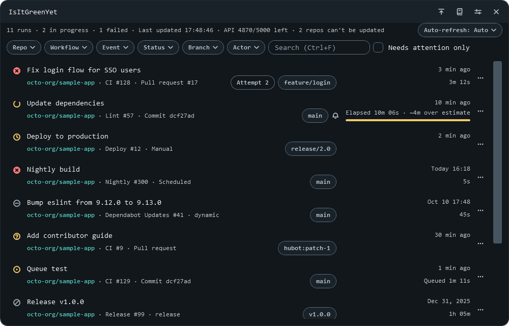

# IsItGreenYet

[](https://github.com/marvin3991/is-it-green-yet/actions)
[](https://github.com/marvin3991/is-it-green-yet/releases/latest)
[](LICENSE)


English | [繁體中文](README.zh-TW.md)

A Windows system tray tool that shows the GitHub Actions runs of your repos and your organizations' repos at a glance, so you can tell whether CI is green yet without opening a window.



## Features

- **Tray status**: a ✕ on red if anything failed, a "…" on yellow if anything is in progress or queued, a ✓ on teal if everything succeeded; a "!" badge means a connection problem.
- **Main window**: the latest 30 runs of each monitored repo, with filters, search, a needs-attention-only view, and the estimated time remaining for in-progress runs.
- **Notifications**: when a tracked run fails, a run you triggered succeeds, a run you marked finishes, or a new version is available, a notification pops up at the bottom right without stealing focus.
- **Saves quota**: polling sends only `GET` requests, with an ETag when it has one; a 304 doesn't count against the primary quota.
- **Re-run and cancel**: off by default; after you turn on write actions in Settings, the run menu can re-run or cancel a run, with a confirmation every time.
- **Command line**: `IsItGreenYet-cli.exe status --json` prints the status as JSON and reports it through the exit code, for use in scripts.
- **Sign-in**: reuses your gh CLI sign-in, or uses a fine-grained PAT (read-only permissions are enough if you only want to see status).
- **No installer, two languages**: a single executable with no installer, though the computer needs the .NET 10 Desktop Runtime first (see [System requirements](#system-requirements)); the interface is in Traditional Chinese or English.

## Not supported

- Checks outside GitHub Actions, such as check runs or commit statuses that other services attach to PRs.
- Re-running a single job, re-running or cancelling several runs at once, and re-run or cancel buttons in notifications or the tray menu.
- Webhooks: a desktop tray app has no publicly reachable receiver, so the app only polls.
- Muting a single workflow (muting is per repo).
- An installer, or replacing itself with a new version: the app tells you about new versions (you can turn that off in Settings), and to upgrade you still replace the exe.

## System requirements

- Windows x64; tested on Windows 11 x64.
- `IsItGreenYet.exe`: install the [.NET 10 Desktop Runtime](https://dotnet.microsoft.com/download/dotnet/10.0) first. You can also install it with winget; this command hasn't actually been run yet:

  ```powershell
  winget install Microsoft.DotNet.DesktopRuntime.10
  ```

- `IsItGreenYet-cli.exe`: needs only the .NET 10 Runtime. The Desktop Runtime already includes it, so there's nothing else to install if you have the Desktop Runtime.
- Signing in with the gh CLI (the default) needs [GitHub CLI](https://cli.github.com/) installed; if you'd rather not install it, use a fine-grained PAT (see [First use](#first-use)).
- Administrator rights: the exe itself doesn't need them by design (running with standard rights hasn't been tested). The runtime installs for the whole computer, so installing it may need them: the winget manifest says `Scope: machine`, so a UAC prompt may appear (inferred).
- If the runtime is missing, the message is in English: the app shows a dialog with a `Download it now` button, and the command line prints an error and a download link (for the exit code, see [Command line](docs/cli.md#exit-codes)). This was seen on 2026-11-05 in a simulation using an environment variable, not on a computer that really lacks the runtime, and the page the link opens hasn't been checked.

## Download and install

Download from [Releases](https://github.com/marvin3991/is-it-green-yet/releases/latest). There's no installer: once the runtime in [System requirements](#system-requirements) is installed, copy the exe to a folder and run it.

| File | Choose it if you want | Size |
|---|---|---|
| `IsItGreenYet.exe` | The app; you always need it | about 3.5 MiB |
| `IsItGreenYet-cli.exe` | The command line in scripts; only if you need it | about 3.2 MiB |

The command line's `status --json` only reads the status written by the app, so it needs the app running. Exact sizes are in [Building from source](docs/building.md#the-two-executables).

To upgrade, exit the app and replace the exe with the new one at the same path.

### No code signing

The exes aren't code-signed, so Windows may show a warning, and each new version may show it again. The first time and for every upgrade, go in this order (when upgrading, compare the hash of the new exe in another folder first, then replace the old file):

1. **Download the exe and `SHA256SUMS.txt` only from this project's [Releases](https://github.com/marvin3991/is-it-green-yet/releases/latest)**, not from other sites or copies passed along by other people.
2. **If Edge holds back the download**: Edge may not save the file right away because few people download it. After checking that the address is this project's Releases, choose to keep the file in Edge's download list (the exact button text hasn't been verified; go by what's on screen). If Edge says outright that the file is harmful, don't keep it; go to step 7.
3. **Move it to a folder of your own**: don't put the exe in a folder that other people or your browser can write to (such as Downloads): a DLL or `gh.exe` with a matching name next to the exe gets loaded.
4. **Compare the hashes**: put `SHA256SUMS.txt` in the same folder and run this in PowerShell; every file you downloaded should show `True`. If one shows `False`, don't run it; delete it and download it again. If nothing is shown, the file name doesn't match the list; change it back to the name in the list and compare again. This only guards against a damaged download, not a swapped file: the list is in the same release as the exe, so anyone who can replace the exe can replace the list too.

   ```powershell
   Get-Content SHA256SUMS.txt | ForEach-Object {
       $hash, $name = $_ -split '\s+', 2
       if (Test-Path -LiteralPath $name) { "$name $((Get-FileHash -LiteralPath $name -Algorithm SHA256).Hash -eq $hash)" }
   }
   ```

5. **Double-click `IsItGreenYet.exe`.** Run `IsItGreenYet-cli.exe` from PowerShell.
6. **If SmartScreen shows a warning**: the first screen says Microsoft Defender SmartScreen prevented an unrecognized app from starting and has only a button to not run it. After "More info", it shows the app's file name and an unknown publisher, and adds "Run anyway". Press "Run anyway" only if the file name is the one whose hash you just compared and the publisher is unknown.
7. **If you get a red block, or Microsoft Defender quarantines the file**: stop, don't try to get around it, and report it in [Issues](https://github.com/marvin3991/is-it-green-yet/issues). The screen's color may follow your system theme, so don't go by color alone: no "Run anyway" button even after pressing "More info", or a statement that the file is harmful, counts too.

The SmartScreen screens above were seen on Traditional Chinese Windows 11 on 2026-11-06 (the 0.3.0 exe with a mark of the web, n=1); the English wording and the Edge download screens haven't been captured yet. The text varies with the Windows and Edge version and language; go by what's on screen.

Don't turn off SmartScreen for this app, and don't work around your company's security policies. A computer with Smart App Control on may not be able to run it at all (not tested), and a company-managed computer may be blocked by policy; in either case, don't use it for now, and you can report it in [Issues](https://github.com/marvin3991/is-it-green-yet/issues).

## First use

Sign in one of two ways:

- **gh CLI (default)**: run `gh auth login`; the app reuses that sign-in, with no other setup.
- **Fine-grained PAT**: in Settings, under "Account", switch to PAT, paste the token, and click "Save".

Details and the permissions a PAT needs are in [Authentication and permissions](docs/authentication.md).

## Basic usage

| To do this | Do this |
|---|---|
| See the overall status | Look at the tray icon (when it first appears, it's in Windows 11's hidden icons area) |
| Open the main window | Left-click the tray icon |
| Refresh now, or search | `F5`, or `Ctrl+F` |
| Show only what needs action | Check "Needs attention only" |
| More actions for a run | The ⋯ button at the right end of the row, or a right-click |
| Mute a repo | "Repo manager" in the title bar |
| Exit | "Exit" in the tray menu; the ✕ in the title bar closes to the tray by default |

Everything else is in [Usage](docs/usage.md).

## Command line

```powershell
.\IsItGreenYet-cli.exe status --json
```

Prints one line of JSON. The exit code gives the overall status, matching the tray (0 success, 1 failure, 2 in progress, 3 no data), or 4 when the status can't be determined, for example when the app isn't running or you're signed out. The full output and exit codes (including when the runtime is missing) are in [Command line](docs/cli.md).

## Data and privacy

- **What it writes**: settings (`settings.json`), a cache of repos, runs, your GitHub login, and mute settings (`cache.db`), and logs (`logs\api.log`, `error.log`) in `%LOCALAPPDATA%\IsItGreenYet`, which can include repo names, so check them before sharing; the `IsItGreenYet` value under `HKCU\Software\Microsoft\Windows\CurrentVersion\Run`, only when Start with Windows is on; and native DLLs extracted from the exe to `%TEMP%\.net\<executable name>\` at startup.
- **Where it connects**: `api.github.com`. IsItGreenYet itself has no telemetry; the .NET Runtime comes from Microsoft, and when the program crashes, it may send data through Windows Error Reporting; see the [Microsoft Privacy Statement](https://go.microsoft.com/fwlink/?LinkID=824704). Every 3 days it also asks `api.github.com` for this project's latest release, using your token; you can turn that off in Settings, and the time of the last check and the version it last notified you about are kept in `settings.json`. Copying failed logs also downloads from another host, because GitHub redirects that download to a signed URL; the token is sent only to `api.github.com`. Links open in your browser only if they start with `https://github.com/`.
- **Where the token is**: with gh CLI, the app gets it by running `gh auth token` and keeps it only in memory. A PAT is stored in Windows Credential Manager (`IsItGreenYet:github.com`). Neither goes into `settings.json`, and the logs mask tokens.

Details are in [Data locations](docs/behavior.md#data-locations).

## Uninstall

1. In Settings, uncheck "Start with Windows (in the tray only)" and save, or delete the `IsItGreenYet` value under `HKCU\Software\Microsoft\Windows\CurrentVersion\Run`. If you moved the exe after turning it on, the box already shows unchecked and the value stays, so delete the value yourself.
2. Exit the app with "Exit" in the tray menu.
3. If you used a PAT, delete `IsItGreenYet:github.com` from Windows Credential Manager.
4. Delete `%LOCALAPPDATA%\IsItGreenYet` (if you started the app from an MSIX-packaged app, also see [Known limitations](docs/known-limitations.md), item 36).
5. Delete `%TEMP%\.net\IsItGreenYet*`.
6. Delete the exe.

Windows 11 itself also keeps a record of the tray icon, including the exe path, under `HKCU\Control Panel\NotifyIconSettings`; the app doesn't write it.

## Build from source

Requires the .NET SDK 10 (`10.0.401` or later) and PowerShell 7.

```powershell
pwsh -File tools/publish.ps1
```

This runs the unit tests and writes the two executables to `dist\`. Details are in [Building from source](docs/building.md).

To release: change the version in both csproj files → open a PR and merge it → create and push a tag → check the draft, verify the exes by hand, and write the release notes by hand → press Publish. Details are in [Release process](docs/building.md#release-process).

## Tech stack

- WPF on .NET 10, with the WinForms `NotifyIcon` for the tray
- SQLite (Microsoft.Data.Sqlite)
- GitHub REST API with ETags
- xUnit

## Documentation

| Document | What it covers |
|---|---|
| [Usage](docs/usage.md) | Every operation, keyboard shortcuts, appearance, and language |
| [Command line](docs/cli.md) | Arguments, JSON output, exit codes, and `--refresh` |
| [Authentication and permissions](docs/authentication.md) | gh CLI, fine-grained PATs, and the permissions write actions need |
| [Building from source](docs/building.md) | Build steps, `publish.ps1` parameters, the two executables, and the release process |
| [Behavior, data locations, and error handling](docs/behavior.md) | Polling, notifications, where files are, and what happens when something fails |
| [Known limitations](docs/known-limitations.md) | Known issues and how to work around them |
| [Development](docs/development.md) (Traditional Chinese) | Project structure, dependencies, CI, commit hook, and progress |
| [Visual design notes](docs/design-notes.md) (Traditional Chinese) | Color palette, icon geometry, layout, and width breakpoints |
| [Deviations from the design specs](docs/spec-deviations.md) (Traditional Chinese) | Where the code differs from the specs |
| [Design specs](docs/specs/2026-10-24-design.md) (Traditional Chinese) | [Monitoring](docs/specs/2026-10-24-design.md) and [write actions and the command line](docs/specs/2026-10-29-phase2-design.md) |
| [Acceptance records](docs/testing/acceptance.md) (Traditional Chinese) | Results of testing on a real machine |
| [Manual test checklist](docs/testing/manual-checklist.md) (Traditional Chinese) | Steps for what automated tests can't cover |

## AI collaboration

This project was developed entirely in collaboration with Anthropic's Claude, including the design specs, code, tests, and documentation.

## License and notices

MIT License, Copyright (c) 2026 Marvin (marvin3991); see [LICENSE](LICENSE) for the full text.

The third-party components in the exes and their licenses are listed in [THIRD-PARTY-NOTICES.md](THIRD-PARTY-NOTICES.md) (Traditional Chinese); for the apphost's license, see item 4 of its 待確認 (open items) section. The MIT License in [LICENSE](LICENSE) covers only this project's own code. You install the .NET Runtime from Microsoft, under Microsoft's terms. The exes also embed the same license and notices: "License and third-party notices" at the bottom of Settings, or `IsItGreenYet-cli.exe notices`.

This project isn't an official GitHub product and isn't affiliated with GitHub, Inc. GitHub is a trademark of GitHub, Inc.

This project isn't an official Anthropic product, isn't affiliated with Anthropic, PBC, and isn't endorsed by Anthropic. Anthropic and Claude are trademarks of Anthropic, PBC.
