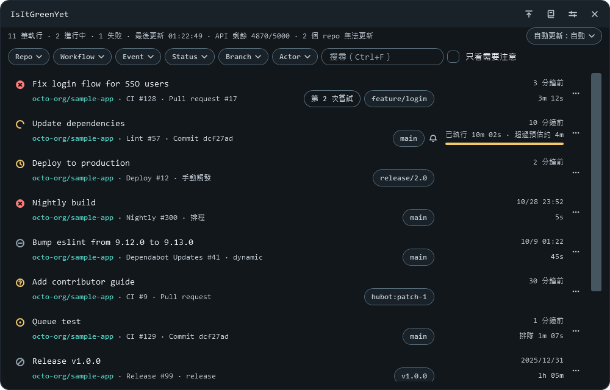

# IsItGreenYet

[](https://github.com/marvin3991/is-it-green-yet/actions)
[](https://github.com/marvin3991/is-it-green-yet/releases/latest)
[](LICENSE)


[English](README.md) | 繁體中文

常駐 Windows 系統匣的工具，一眼看到自己與所屬組織 repo 的 GitHub Actions 執行狀況，不必開視窗就知道 CI 綠燈了沒。



## 功能

- **系統匣狀態**：有失敗是紅底 ✕、有進行中或排隊是黃底「…」、全部成功是青綠底 ✓；「!」角標代表連線有問題。
- **主畫面**：每個監看中 repo 最近 30 筆 run，可以篩選、搜尋、只看需要注意的，進行中的 run 顯示預估剩餘時間。
- **提示**：追蹤中的 run 失敗、你觸發的 run 成功、你標記的 run 完成，或有新版本時，螢幕右下角跳出提示，不搶焦點。
- **省額度**：輪詢只送 `GET`，有 ETag 就帶上；回 304 不扣主額度。
- **重跑與取消**：預設關閉；在設定頁開啟寫入功能後，run 選單可以重跑或取消，每次都先確認。
- **命令列**：`IsItGreenYet-cli.exe status --json` 輸出 JSON，用退出碼表示狀態，給腳本用。
- **登入**：沿用 gh CLI 的登入，或改用 fine-grained PAT（只看狀態時給唯讀權限即可）。
- **沒有安裝程式、雙語**：單一執行檔，不需要安裝程式，但電腦要先裝 .NET 10 Desktop Runtime（見[系統需求](#系統需求)）；介面有繁體中文與 English。

## 不支援的項目

- GitHub Actions 以外的 check，例如其他服務掛在 PR 上的 check run 或 commit status。
- 重跑單一 job、一次重跑或取消多筆 run，以及提示視窗與系統匣選單上的重跑、取消按鈕。
- Webhook：桌面常駐程式沒有對外可達的接收端，所以只輪詢。
- 依 workflow 靜音（靜音是 repo 層級）。
- 安裝程式，以及程式自己換成新版本：有新版本時會提示（可以在設定頁關閉），要升級還是替換 exe。

## 系統需求

- Windows x64；在 Windows 11 x64 上測試。
- `IsItGreenYet.exe`：要先裝 [.NET 10 Desktop Runtime](https://dotnet.microsoft.com/download/dotnet/10.0)。也可以用 winget 安裝，這行指令還沒有實際跑過：

  ```powershell
  winget install Microsoft.DotNet.DesktopRuntime.10
  ```

- `IsItGreenYet-cli.exe`：只需要 .NET 10 Runtime。Desktop Runtime 已包含它，裝了 Desktop Runtime 就不用另外裝。
- 用 gh CLI 登入（預設）時要先裝 [GitHub CLI](https://cli.github.com/)；不想裝就用 fine-grained PAT（見[第一次使用](#第一次使用)）。
- 系統管理員權限：exe 本身依設計不需要（以一般權限執行還沒有實測）。Runtime 是裝到整台電腦，安裝時可能需要：winget 的 manifest 寫 `Scope: machine`，可能跳出 UAC 確認（推論）。
- 缺 Runtime 時的提示是英文：App 跳出對話框，上面有 `Download it now` 按鈕；命令列印錯誤訊息與下載連結，退出碼見[命令列](docs/cli.zh-TW.md#退出碼)。這是 2026-11-05 用環境變數模擬看到的，沒有在真的沒裝 Runtime 的電腦上試過，連結開到的頁面也沒有驗證。

## 下載與安裝

從 [Releases](https://github.com/marvin3991/is-it-green-yet/releases/latest) 下載。沒有安裝程式：裝好[系統需求](#系統需求)的 Runtime 之後，把 exe 複製到資料夾直接執行。

| 檔案 | 什麼時候選它 | 大小 |
|---|---|---|
| `IsItGreenYet.exe` | App，一定要有 | 約 3.5 MiB |
| `IsItGreenYet-cli.exe` | 要在腳本裡用命令列時才需要 | 約 3.2 MiB |

命令列的 `status --json` 只讀 App 寫的狀態，所以要搭配執行中的 App 使用。精確的大小見[自行建置](docs/building.zh-TW.md#兩個執行檔)。

升級時先結束程式，再用新的 exe 替換同一個路徑的舊檔。

### 沒有程式碼簽章

exe 沒有程式碼簽章，Windows 可能跳出警告，每個新版本都可能再跳一次。第一次使用與每次升級都照這個順序（升級時，新的 exe 先放在另一個資料夾比對雜湊，再替換舊檔）：

1. **只從本專案的 [Releases](https://github.com/marvin3991/is-it-green-yet/releases/latest) 下載** exe 與 `SHA256SUMS.txt`，不要用別的網站或別人轉傳的檔案。
2. **Edge 攔下下載時**：Edge 可能因為這個檔案很少人下載，不直接存檔。確認網址是本專案的 Releases 之後，在 Edge 的下載清單選擇保留這個檔案（確切的按鈕文字還沒有驗證，以畫面為準）。Edge 明白說檔案有害時不要保留，照第 7 步處理。
3. **移到自己專用的資料夾**：不要把 exe 放在別人或瀏覽器能寫入的資料夾（例如下載資料夾），exe 旁邊的同名 DLL 或 `gh.exe` 會被載入。
4. **比對雜湊**：把 `SHA256SUMS.txt` 放在同一個資料夾，在 PowerShell 執行下面的指令；下載的每個檔案都應該顯示 `True`；顯示 `False` 就不要執行，刪掉重新下載；一行都沒有顯示表示檔名和清單不同，先改回清單上的檔名再比對。這只防下載損毀，不防掉包：清單和 exe 放在同一個 release，能換掉 exe 的人也能換掉清單。

   ```powershell
   Get-Content SHA256SUMS.txt | ForEach-Object {
       $hash, $name = $_ -split '\s+', 2
       if (Test-Path -LiteralPath $name) { "$name $((Get-FileHash -LiteralPath $name -Algorithm SHA256).Hash -eq $hash)" }
   }
   ```

5. **雙擊 `IsItGreenYet.exe`**。`IsItGreenYet-cli.exe` 要在 PowerShell 裡執行。
6. **SmartScreen 跳出警告時**：標題是「Windows 已保護您的電腦」，內文寫 Microsoft Defender SmartScreen 已防止某個無法辨識的應用程式啟動，只有「不要執行」一個按鈕。按「其他資訊」之後會列出應用程式的檔名與「發行者: 不明的發行者」，並多出「仍要執行」。檔名是你剛比對過雜湊的那一個、發行者是不明的發行者，才按「仍要執行」。
7. **紅色封鎖，或 Microsoft Defender 把檔案隔離時**：停下來，不要想辦法放行，到 [Issues](https://github.com/marvin3991/is-it-green-yet/issues) 回報。畫面顏色可能跟著系統主題，不要只看顏色：按了「其他資訊」之後還是沒有「仍要執行」，或明白寫檔案有害，都算這一種。

上面 SmartScreen 的文字是 2026-11-06 在繁體中文的 Windows 11 看到的（帶網路標記的 0.3.0，n=1）；Edge 的下載畫面還沒有實際截到。這些文字依 Windows、Edge 的版本與語言不同，以畫面為準。

不要為了這個程式關閉 SmartScreen，也不要繞過公司的安全政策。開著 Smart App Control 的電腦可能完全跑不起來（沒有實測），公司管理的電腦可能被政策擋下；碰到這兩種情況就先不要用，可以到 [Issues](https://github.com/marvin3991/is-it-green-yet/issues) 回報。

## 第一次使用

用下面兩種方式之一登入：

- **gh CLI（預設）**：執行 `gh auth login`，程式沿用這個登入，不需要另外設定。
- **fine-grained PAT**：在設定頁「帳號」切到 PAT，貼上 token，按「儲存」。

細節與 PAT 需要的權限見[認證與權限](docs/authentication.zh-TW.md)。

## 基本使用

| 想做的事 | 怎麼做 |
|---|---|
| 看整體狀態 | 看系統匣圖示（第一次出現時在 Windows 11 的「隱藏的圖示」區） |
| 開主畫面 | 左鍵點系統匣圖示 |
| 立即刷新，或搜尋 | `F5`，或 `Ctrl+F` |
| 只看要處理的 | 勾「只看需要注意」 |
| 對某筆 run 做更多操作 | 每列最右邊的 ⋯ 按鈕，或按右鍵 |
| 靜音 repo | 標題列的「repo 管理」 |
| 結束 | 系統匣右鍵「結束」；標題列的 ✕ 預設是收到系統匣 |

其他操作見[使用說明](docs/usage.zh-TW.md)。

## 命令列

```powershell
.\IsItGreenYet-cli.exe status --json
```

輸出一行 JSON。退出碼表示整體狀態，和系統匣一致（0 成功、1 失敗、2 進行中、3 無資料）；App 沒在執行或未登入這類無法判斷狀態的情況回 4。完整的輸出與退出碼（包括缺 Runtime 的情況）見[命令列](docs/cli.zh-TW.md)。

## 資料與隱私

- **程式寫了什麼**：`%LOCALAPPDATA%\IsItGreenYet` 裡的設定（`settings.json`）、repo、run、GitHub 帳號名稱與靜音設定的快取（`cache.db`）、紀錄（`logs\api.log`、`error.log`），這些檔案可能含 repo 名稱，分享前要先檢查；`HKCU\Software\Microsoft\Windows\CurrentVersion\Run` 的 `IsItGreenYet` 值，只有開啟開機自動啟動時才寫；以及啟動時從 exe 解壓到 `%TEMP%\.net\<執行檔名稱>\` 的原生 DLL。
- **連到哪裡**：`api.github.com`。IsItGreenYet 本身沒有遙測；.NET Runtime 由 Microsoft 提供，程式當機時可能經 Windows 錯誤回報送出資料，見 [Microsoft 隱私聲明](https://go.microsoft.com/fwlink/?LinkID=824704)。每 3 天也會用你的 token 向 `api.github.com` 查本專案最新的 release，可以在設定頁關閉，上次檢查時間與通知過的版本記在 `settings.json`。複製失敗 log 時也會從另一個主機下載，因為 GitHub 會把下載轉址到簽章網址；token 只送往 `api.github.com`。只有 `https://github.com/` 開頭的連結才會用瀏覽器開啟。
- **token 在哪裡**：gh CLI 模式由程式執行 `gh auth token` 取得，只放在記憶體。PAT 存在 Windows 認證管理員（`IsItGreenYet:github.com`）。兩者都不會寫進 `settings.json`，紀錄裡的 token 會遮罩。

細節見[資料位置](docs/behavior.zh-TW.md#資料位置)。

## 解除安裝

1. 在設定頁取消勾選「開機自動啟動（開機時只出現在系統匣）」並儲存，或刪除 `HKCU\Software\Microsoft\Windows\CurrentVersion\Run` 的 `IsItGreenYet` 值。開啟後搬動過 exe 時，設定頁本來就顯示沒勾、值也不會被刪，要自己刪除。
2. 用系統匣右鍵「結束」結束程式。
3. 有用 PAT 時，刪除 Windows 認證管理員裡的 `IsItGreenYet:github.com`。
4. 刪除 `%LOCALAPPDATA%\IsItGreenYet`（從 MSIX 封裝的程式啟動過 App 時，另見[已知限制](docs/known-limitations.zh-TW.md)第 36 項）。
5. 刪除 `%TEMP%\.net\IsItGreenYet*`。
6. 刪除 exe。

Windows 11 自己也會在 `HKCU\Control Panel\NotifyIconSettings` 留一筆這個系統匣圖示的紀錄，含 exe 路徑；這不是程式寫的。

## 從原始碼建置

需求：.NET SDK 10（`10.0.401` 起）、PowerShell 7。

```powershell
pwsh -File tools/publish.ps1
```

會跑單元測試，再把兩個執行檔輸出到 `dist\`。細節見[自行建置](docs/building.zh-TW.md)。

發版：改兩個 csproj 的版本 → 開 PR、合併 → 打 tag 並推送 → 確認 draft 內容、親手驗 exe、手寫 release notes → 按 Publish。細節見[發版流程](docs/building.zh-TW.md#發版流程)。

## 技術棧

- WPF／.NET 10，系統匣用 WinForms 的 `NotifyIcon`
- SQLite（Microsoft.Data.Sqlite）
- GitHub REST API（ETag）
- xUnit

## 文件索引

| 文件 | 內容 |
|---|---|
| [使用說明](docs/usage.zh-TW.md) | 所有操作、鍵盤快速鍵、外觀與語言 |
| [命令列](docs/cli.zh-TW.md) | 參數、JSON 輸出、退出碼、`--refresh` |
| [認證與權限](docs/authentication.zh-TW.md) | gh CLI、fine-grained PAT、寫入功能需要的權限 |
| [自行建置](docs/building.zh-TW.md) | 建置步驟、`publish.ps1` 的參數、兩個執行檔、發版流程 |
| [行為、資料位置與例外處理](docs/behavior.zh-TW.md) | 輪詢、通知、檔案在哪裡、出問題時會怎樣 |
| [已知限制](docs/known-limitations.zh-TW.md) | 已知的問題與避開方式 |
| [開發說明](docs/development.md) | 專案結構、相依套件、CI、commit hook、進度 |
| [視覺設計說明](docs/design-notes.md) | 色票、圖示幾何、版面、寬度斷點 |
| [和設計規格的差異](docs/spec-deviations.md) | 程式和規格不一致的地方 |
| [設計規格](docs/specs/2026-10-24-design.md) | [監看](docs/specs/2026-10-24-design.md)、[寫入功能與命令列](docs/specs/2026-10-29-phase2-design.md) |
| [實機驗收紀錄](docs/testing/acceptance.md) | 在實機測試的結果 |
| [手動測試清單](docs/testing/manual-checklist.md) | 自動測試涵蓋不到的項目與步驟 |

## AI 協作

本專案全程由 Anthropic 的 Claude 協作開發，包括設計規格、程式碼、測試與文件。

## 授權與聲明

MIT License，Copyright (c) 2026 Marvin (marvin3991)，全文見 [LICENSE](LICENSE)。

exe 裡的第三方元件與授權見 [THIRD-PARTY-NOTICES.md](THIRD-PARTY-NOTICES.md)，其中 apphost 的授權見待確認第 4 項；[LICENSE](LICENSE) 的 MIT 只涵蓋本專案自己的程式。.NET Runtime 由你向 Microsoft 安裝，依 Microsoft 的條款。exe 也內嵌同一份授權與聲明：設定頁最下方的「授權與第三方聲明」，或 `IsItGreenYet-cli.exe notices`。

本專案不是 GitHub 官方產品，與 GitHub, Inc. 無關；GitHub 是 GitHub, Inc. 的商標。

本專案不是 Anthropic 官方產品，與 Anthropic, PBC 無關，也沒有受到 Anthropic 背書；Anthropic 與 Claude 是 Anthropic, PBC 的商標。
